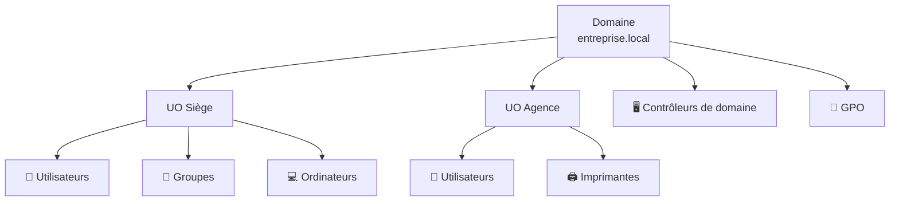

[Sommaire](Readme.md) · [Chapitre suivant →](02-DNS.md)

# Active Directory

## 🎯 Objectifs du chapitre

- Situer Active Directory et ce qu'il centralise
- Connaître l'intérêt d'un annuaire
- Comprendre le rôle du contrôleur de domaine
- Présenter le protocole LDAP et le contenu de l'annuaire

---

## 1. Présentation

Active Directory s'appelait auparavant **NTDS**, pour *NT Directory Services*
— « service d'annuaire de NT », à l'époque de Windows NT.

C'est un **service d'annuaire LDAP** pour les systèmes Windows, créé par
Microsoft en 1996 et livré avec Windows Server depuis la version 2000. Son
objectif principal : fournir des services **centralisés d'identification et
d'authentification** à un réseau d'ordinateurs Windows.

Il répertorie les éléments du réseau administré : comptes utilisateurs,
serveurs, postes de travail, dossiers partagés, imprimantes…

---

## 2. Généralités

### Ce que centralise Active Directory

- **Les ressources** : postes de travail, imprimantes, scanners, dossiers partagés…
- **Les utilisateurs** : comptes individuels et groupes, avec leurs droits et leurs services ;
- **Les services** : messagerie, portail collaboratif, GED…

### Intérêts d'un annuaire

| Intérêt | Ce que cela apporte |
|---|---|
| **Administration centralisée et simplifiée** | tous les objets — comptes utilisateurs, ordinateurs — sont gérés au même endroit ; l'annuaire sert aussi de support à d'autres tâches, comme le déploiement de stratégies de groupe |
| **Authentification unifiée** | un utilisateur authentifié sur une machine, elle-même authentifiée, accède aux ressources des autres serveurs de l'annuaire, sous réserve d'autorisations |
| **Identification des objets** | chaque objet de l'annuaire est unique, donc facile à identifier et à retrouver |
| **Référencement** | l'annuaire est une vaste base de données des utilisateurs, groupes et ordinateurs de l'entreprise |

---

## 3. Le contrôleur de domaine (DC)

Un **contrôleur de domaine** est un serveur qui répond aux demandes
d'authentification et contrôle les objets du domaine — utilisateurs,
périphériques, services — pour les organiser, les configurer et les sécuriser.

### Fonction principale

Sa mission première est d'**authentifier** l'utilisateur et le poste de
travail, puis de valider leur accès au réseau : à la connexion, le DC vérifie
l'identifiant et le mot de passe, puis autorise ou refuse l'accès.

Microsoft Active Directory et Microsoft Entra ID (anciennement Azure AD) en
sont les exemples les plus courants ; **Samba** permet de jouer ce rôle sous
Linux.

### Avantages et vulnérabilités

| ✔ Avantages | ✘ Vulnérabilités |
|---|---|
| Gestion centralisée des utilisateurs, postes et serveurs | Cible privilégiée des cyberattaques |
| Gestion centralisée des services | Susceptible d'être compromis : qui le contrôle contrôle tout le domaine |
| Partage des fichiers et imprimantes | Tout le réseau dépend de sa disponibilité |
| Redondance si plusieurs DC | Exigences matérielles et logicielles |
| Chiffrement des données utilisateur | |

> ⚠️ Un domaine ne doit jamais reposer sur un seul DC : deux au minimum,
> pour que la panne de l'un ne paralyse pas l'entreprise.

---

## 4. L'annuaire LDAP

**LDAP** (*Lightweight Directory Access Protocol*) est un protocole standard de
gestion d'annuaires : il donne accès, par TCP/IP, à des bases d'informations
sur les utilisateurs d'un réseau.

| Protocole | Port | Sécurité |
|---|---|---|
| LDAP | 389/TCP | en clair |
| LDAPS (*LDAP over SSL/TLS*) | 636/TCP | chiffré |

### Un annuaire globalement distribué

L'annuaire est accessible en tout point du réseau : tous les utilisateurs,
ordinateurs et services de l'entreprise peuvent consulter ses informations,
dans la limite des droits qui leur sont accordés.

### Contenu de l'annuaire

L'annuaire LDAP de Microsoft, c'est Active Directory. Il contient des
**unités d'organisation** (UO) qui forment l'arborescence du domaine, et des
objets de différents types :

Pour chaque classe d'objets et chaque objet, l'annuaire stocke des
**attributs** et leurs valeurs. Pour un utilisateur : nom, prénom,
description, mot de passe, adresse électronique…

---

## ✅ Vérifier ses acquis

1. Quel est l'ancien nom d'Active Directory ?
2. Sur quel port communique LDAP ? Et LDAPS ?
3. Pourquoi le contrôleur de domaine est-il une cible privilégiée des attaquants ?

Voir la correction

1. NTDS, pour *NT Directory Services*.
2. 389/TCP pour LDAP, 636/TCP pour LDAPS.
3. Il authentifie tout le monde et détient l'annuaire : le compromettre, c'est obtenir les clés de tout le domaine.

---

[Sommaire](Readme.md) · [Chapitre suivant →](02-DNS.md)
