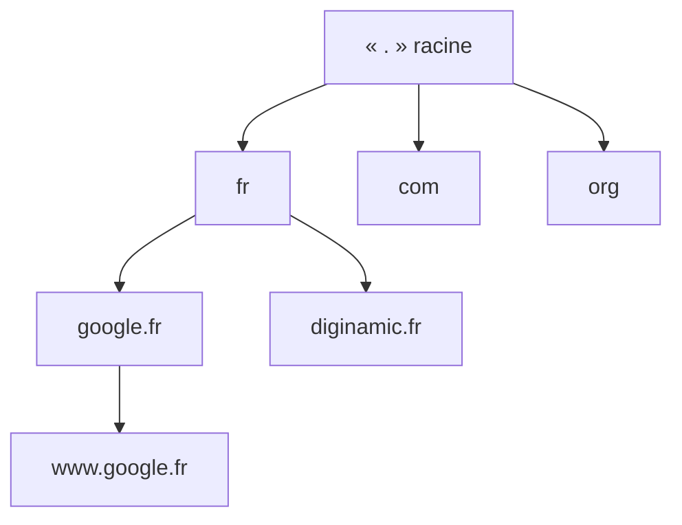
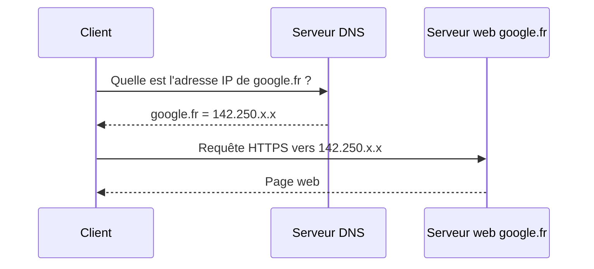

[← Chapitre précédent](01-Active-Directory.md) · [Sommaire](Readme.md) · [Chapitre suivant →](03-DHCP.md)

# La résolution de noms : DNS

## 🎯 Objectifs du chapitre

- Comprendre le besoin de résolution de noms
- Connaître NetBIOS et ses limites
- Décrire les composants et le fonctionnement de DNS

---

## 1. La résolution de noms

Pour communiquer avec un ordinateur ou un serveur distant, il faut connaître
son **adresse IP**. Impossible, pour un utilisateur, de retenir les adresses
de tous les serveurs : des mécanismes de **résolution de noms** traduisent
les noms en adresses IP — et inversement.

---

## 2. NetBIOS

NetBIOS est le premier système de résolution de noms employé par Microsoft.
Il s'appuie sur le protocole NetBEUI (*NetBIOS Extended User Interface*),
issu des travaux d'IBM au début des années 1980.

Ses caractéristiques :

- noms limités à **16 caractères** ;
- résolution par **broadcast** ;
- système **non hiérarchique**, donc inutilisable à l'échelle d'Internet ;
- système propre à Microsoft.

---

## 3. DNS — Domain Name System

DNS a été conçu pour dépasser ces limites. Il repose sur une organisation
**hiérarchique**, dont la racine est coordonnée par l'**ICANN** (*Internet
Corporation for Assigned Names and Numbers*).

| | NetBIOS | DNS |
|---|---|---|
| Structure | plate | hiérarchique |
| Résolution | broadcast | requête à un serveur |
| Portée | réseau local | Internet |
| Longueur des noms | 16 caractères | jusqu'à 253 caractères |

### Composants nécessaires

- un **serveur DNS**, dont la base de données associe des noms à des adresses IP ;
- un **client DNS**, paramétré pour interroger ce serveur.

### Fonctionnement

1. Le client a besoin de l'adresse IP correspondant à un nom de domaine : il interroge le serveur DNS.
2. Le serveur DNS lui répond avec l'adresse IP correspondante.
3. Le client contacte le serveur distant à l'adresse nouvellement apprise.

Exemple : un client souhaite accéder au site `google.fr`.

> 💡 Sous Windows, `nslookup google.fr` interroge le serveur DNS configuré et
> affiche sa réponse : c'est le premier outil de diagnostic d'un problème de
> résolution.

---

## ✅ Vérifier ses acquis

1. Pourquoi NetBIOS ne peut-il pas servir sur Internet ?
2. Quels sont les deux composants nécessaires au fonctionnement de DNS ?
3. Quel organisme coordonne la hiérarchie des noms de domaine ?

Voir la correction

1. Il est plat (non hiérarchique) et résout par broadcast, qui ne franchit pas les routeurs.
2. Un serveur DNS (la base de correspondances) et un client DNS paramétré pour l'interroger.
3. L'ICANN.

---

[← Chapitre précédent](01-Active-Directory.md) · [Sommaire](Readme.md) · [Chapitre suivant →](03-DHCP.md)
