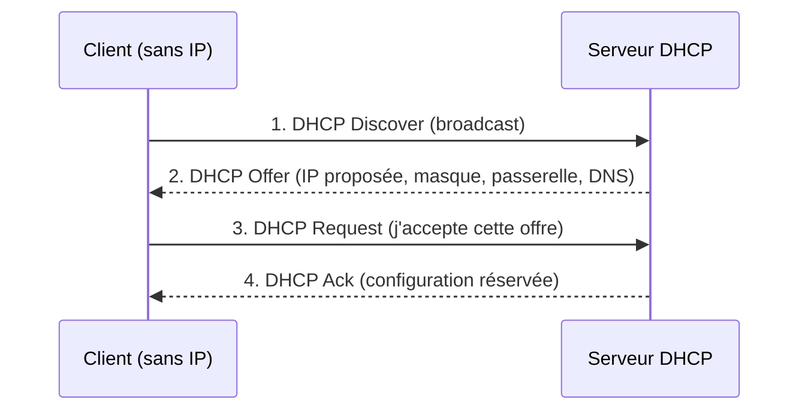

[← Chapitre précédent](02-DNS.md) · [Sommaire](Readme.md)

# DHCP — Dynamic Host Configuration Protocol

DHCP est un protocole client-serveur qui permet à un hôte qui se connecte à un
réseau d'obtenir **automatiquement** la configuration de sa carte réseau
auprès d'un serveur DHCP.

## 🎯 Objectifs du chapitre

- Connaître les composants d'un système DHCP
- Décrire les quatre étapes de l'échange DHCP
- Comprendre la notion de bail

---

## 1. Composants nécessaires

- un **serveur DHCP**, configuré pour fournir les informations de
  configuration : adresse IP, masque, passerelle, serveurs DNS ;
- un **client DHCP**, dont la carte réseau est configurée en mode dynamique.

---

## 2. Fonctionnement : l'échange DORA

Lorsque le client se connecte au réseau :

1. **Discover** — il émet en broadcast une requête *DHCP Discover* ;
2. **Offer** — si un serveur DHCP est présent sur le réseau, il répond par un
   *DHCP Offer*, qui contient la configuration qu'il propose au client ;
3. **Request** — le client signale qu'il souhaite utiliser cette configuration
   par un *DHCP Request* ;
4. **Ack** — le serveur accuse réception, réserve la configuration pour le
   client et l'en informe par un *DHCP Ack*.

L'acronyme **DORA** — *Discover, Offer, Request, Ack* — résume l'échange.

---

## 3. Le bail

La configuration attribuée au client lui est réservée pour une durée fixée :
c'est la **durée du bail**, paramétrée sur le serveur DHCP. Avant son
expiration, le client demande son renouvellement ; s'il quitte le réseau,
l'adresse redevient disponible à l'échéance.

> 💡 Sous Windows, `ipconfig /release` rend le bail et `ipconfig /renew` en
> demande un nouveau : pratique pour rejouer l'échange DORA lors d'un
> diagnostic.

---

## ✅ Vérifier ses acquis

1. Pourquoi la première requête du client est-elle envoyée en broadcast ?
2. Remettez dans l'ordre : Request, Ack, Discover, Offer.
3. Qu'est-ce que la durée du bail ?

Voir la correction

1. Le client n'a pas encore d'adresse IP et ne connaît pas celle du serveur DHCP.
2. Discover, Offer, Request, Ack (DORA).
3. La durée pendant laquelle la configuration attribuée est réservée au client ; elle est fixée sur le serveur.

---

[← Chapitre précédent](02-DNS.md) · [Sommaire](Readme.md)
