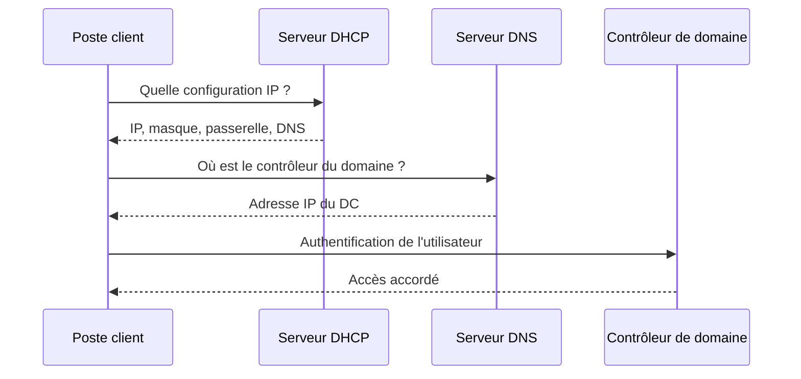

  <picture>
    <source media="(prefers-color-scheme: dark)" srcset="assets/Logo-diginamic-color-blk.png">
    
  </picture>

# Active Directory, DNS et DHCP

Les trois services socles d'un réseau d'entreprise Windows : l'annuaire qui
identifie et authentifie, la résolution de noms qui permet de se trouver, et
la distribution automatique des configurations IP.

**Auteur :** Nicolas SAHUC <sahuc.nic@gmail.com>

## 🎯 Objectifs pédagogiques

À la fin de ce cours, vous saurez :

1. Expliquer le rôle d'Active Directory et l'intérêt d'un annuaire centralisé.
2. Décrire les fonctions, les avantages et les vulnérabilités d'un contrôleur de domaine.
3. Présenter le protocole LDAP et le contenu de l'annuaire.
4. Expliquer la résolution de noms, de NetBIOS à DNS, et le fonctionnement d'une requête DNS.
5. Décrire l'échange DHCP (DORA) et la notion de bail.

## ❔ Pourquoi ce cours ?

Un utilisateur qui allume son poste dans une entreprise obtient une adresse IP
(DHCP), trouve son contrôleur de domaine (DNS), puis s'y authentifie (Active
Directory). Sans ces trois services, rien ne fonctionne : ce sont les
premiers à installer, et les premiers à suspecter en cas de panne.

## Le parcours

| # | Étape | Durée | Ce qu'on y fait |
|---|---|---|---|
| [01](01-Active-Directory.md) | Active Directory | 1 h 30 | l'annuaire, son intérêt, le contrôleur de domaine, LDAP |
| [02](02-DNS.md) | La résolution de noms : DNS | 1 h | NetBIOS, DNS, composants et fonctionnement d'une requête |
| [03](03-DHCP.md) | DHCP | 1 h | composants, échange DORA, bail |
